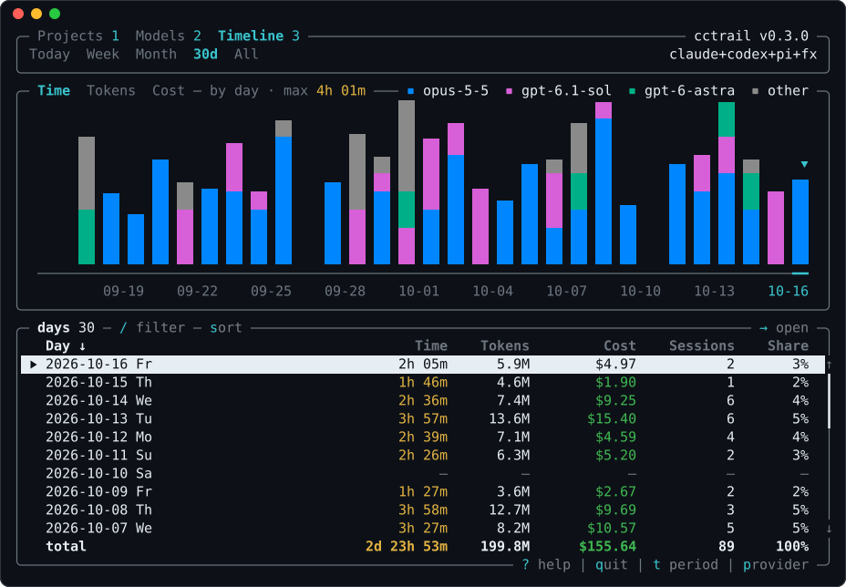
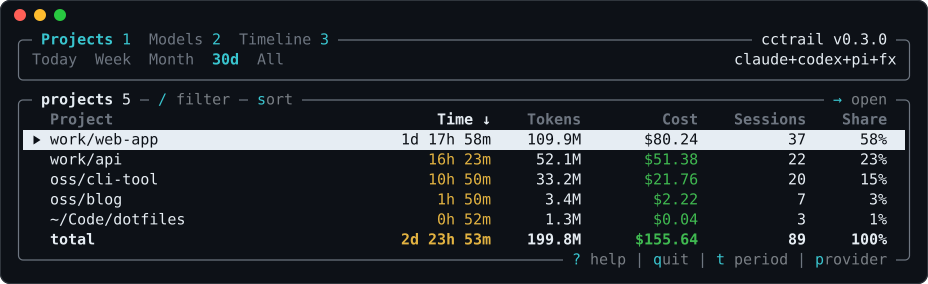

<div align="center">

# cctrail

**Where your AI coding time and tokens go, per project**

[](https://crates.io/crates/cctrail)
[](https://github.com/vladkens/cctrail/blob/main/LICENSE)
[](https://x.com/uid127)

</div>

`cctrail` reads the local history of Claude Code, Codex, [pi](https://pi.dev) and
[fx](https://fx.sh) and shows, for each project, how much time you spent in it, how many tokens it
used and what that would cost at API prices. It needs no setup: repositories are found from the
sessions themselves, with agent worktrees and clones counted as one project.

<div align="center">
  
</div>

## 🌟 Features

- ⏱️ **Real hours.** Active time per project: idle gaps don't count, parallel projects split it.
- 💰 **Estimated cost.** Each request at the **API price of its day**, to compare with your
  subscription.
- 🧮 **No double counting.** History copied into subagents, forks or another profile counts once.
- 🌳 **No setup.** Reads the history already on disk; worktrees and clones fold into their
  repository.
- 👥 **All accounts.** Every Claude Code and Codex profile (`~/.claude-work`) in one report.
- 🖥️ **Interactive.** Projects, models and a timeline by model, with drill-downs and the mouse.
- 📊 **Scriptable.** Reports by day, week or month, per project, group or model, and JSON.
- ⚡ **Fast and private.** Seconds for gigabytes of history, which never leaves your machine.

## 📥 Installation

Download the archive for macOS (Apple Silicon), Linux (x86_64 or arm64, glibc 2.28 or newer) or
Windows (x86_64) from the [latest release](https://github.com/vladkens/cctrail/releases/latest)
and put `cctrail` (`cctrail.exe`) into a folder on your `PATH`, such as `~/.local/bin`. Or build
it with Rust:

```sh
cargo install cctrail
```

### Newest version

This readme follows main, which may be ahead of the latest release. Binaries of main are in the
[dev release](https://github.com/vladkens/cctrail/releases/tag/dev), or build it with Rust:

```sh
cargo install --git https://github.com/vladkens/cctrail
```

## 🚀 Usage

```sh
cctrail                      # on a terminal: the interactive view (projects, models, timeline)
cctrail all                  # time, tokens and cost per project as text, all time
cctrail this-month           # for a period: today, yesterday, this-week, last-week, this-month, last-month
cctrail --since 2026-03-01   # from a date; --until sets the last day, both inclusive YYYY-MM-DD
cctrail --all                # every row; by default unconfigured dirs past 95% of the time fold into `other`
cctrail --by group           # per group from the config, or --by dir per working directory
cctrail here                 # the current directory's project: today, this week, this month, all time
cctrail days                 # per day; also weeks, months, and --models for a breakdown by model
cctrail --provider codex     # one harness only: claude, codex, pi or fx
cctrail --json               # everything with full paths and exact counts
cctrail update-pricing       # download the latest prices now
```

Any argument, `--json` or a pipe prints a text report; `NO_COLOR=1` turns its colors off. Weeks
start on Monday. `cctrail --help` lists it all.

### Interactive view

`cctrail` without arguments on a terminal opens the interactive view: projects, models, a
timeline (a chart of the days stacked by model over their list) and swears for today, this week,
this month, the last 30 days or all time. Press `?` in it to see the keys.

Swears lists per model the words you typed to it, the swear words among them, their rate per 1,000
words and the share of your prompts with swearing. Score is that rate pulled toward your overall
one by 2,000 words, so a model you barely used sits near your average instead of at the top.

<div align="center">
  
</div>

| Key | Action |
| --- | --- |
| `1` `2` `3` `4` | Projects, Models, Timeline, Swears |
| `t` `T` | The next or the previous period |
| `↑` `↓` `PgUp` `PgDn` `Home` `End` | Move the selection |
| `→` `Enter` | Open the row: a project's models, a model's speeds and efforts, a day's projects |
| `←` `Esc` `q` | Back; `q` quits from a list |
| `s` `S` | Sort by the next column, reverse the sort; on the timeline `s` switches the bars between time, tokens and cost |
| `p` | The provider: all, claude, codex, pi or fx |
| `/` | Filter by name: `Enter` keeps the filter, `Esc` clears it |
| `?` | The keys |

The mouse works too: a click selects a row or a bar and a second one opens it, a click on a column
header sorts and a second one reverses, a click on a view, period or provider switches it, and the
wheel moves the selection.

<a name="projects"></a>

## 📁 Projects

Every repository is a row, named by its directory. Agent worktrees count as their repository
(`<repo>/.claude/worktrees/<name>`, any `<repo>/.<tool>/worktrees/<name>`,
`<repo>/.worktrees/<name>` and `<repo>-worktrees/<name>`), and clones of one repository at other
paths (directories with the same name) count as the one used last. Temp directories, directories
that hold other projects (`~/Code`) and clones Codex saw with different git remotes stay apart.

A config is optional: it names projects, merges several repositories into one and puts projects in
groups for `--by group`. It lives in `~/.config/cctrail/config.toml` (`XDG_CONFIG_HOME` moves the
root, `CCTRAIL_CONFIG` sets the full path):

```toml
[projects]
"work/web-app" = ["~/Code/web-app", "~/Code/web-app-docs"]
"oss/cli-tool" = ["~/Code/cli-tool"]
```

Each key is `<group>/<project>`. A path includes everything below it, and the longest match wins.
Repositories outside the config keep their own rows and form the `@unmapped` group.

## 🧮 How it counts

### History

| Harness | Reads | Override |
| --- | --- | --- |
| Claude Code | `~/.claude/projects` and the same in every profile beside it (`~/.claude-work`) | `CLAUDE_CONFIG_DIR` replaces all of them with one root |
| Codex | `~/.codex/sessions` and `~/.codex/archived_sessions`, and the same in every profile beside them (`~/.codex-personal`) | `CODEX_HOME` replaces all of them with one root |
| pi | `~/.pi/agent/sessions` and an absolute `sessionDir` from its `settings.json` | `PI_CODING_AGENT_DIR` moves the agent directory, `PI_CODING_AGENT_SESSION_DIR` replaces both |
| fx | `~/.fx/sessions` | `FX_HOME`, which only cctrail reads, moves `~/.fx` |

A forked pi session counts only what it added to the copy of its source. fx logs a session's tokens
only as totals, so they are spread over its agents' activity, a share on every active day: exact
per project, approximate per day. Claude Code deletes sessions older than 30 days by default: raise
[`cleanupPeriodDays`](https://code.claude.com/docs/en/claude-directory#cleaned-up-automatically)
to keep a long history.

### Swearing

The Swears view counts only what you typed in a main session: no tool output, nothing the harness
adds (slash commands and their output, reminders, environment context, skills, notifications,
summaries of compacted history), no prompts that agents get from a model, and none of `codex exec`
or the Claude Agent SDK, which scripts and other agents send. A prompt counts toward the model that
answered last before it, the first ones of a session toward the first to answer; one that a fork
or a copied file repeats counts once. Rates show from 200 words up. Only each prompt's counts of
words and swear words are kept, never its text, and only for the interactive view.

The words come from [`src/swear/en.txt`](src/swear/en.txt) and
[`src/swear/ru.txt`](src/swear/ru.txt), one per line: `word` matches the word, `stem*` every word
it starts, `!word` and `!stem*` never match (a stem's false positives). Your own lists in that
format go in `~/.config/cctrail/swear/*.txt`. Lists for other languages are welcome as pull
requests.

### Time

Every message opens a five-minute window; overlapping windows merge, and time spent in several
projects at once is split between them. Tables show `8h 14m`, or `45d 8h 14m` from a day on.

### Cost

An estimate at [models.dev](https://models.dev) prices, each request at the price of its day, so a
later price cut doesn't reprice old usage. Prices come from the models.dev git history and are
refreshed in the background once a day (`cctrail update-pricing` does it now,
`CCTRAIL_NO_UPDATE=1` turns it off). `codex-auto-review`, which has no price, counts as
`gpt-6-luna`.

pi's and fx's models read and are priced alike whatever the provider (Bedrock's
`us.anthropic.claude-opus-4-6-v1` as `claude-opus-4-6`, a router's `openai/gpt-5.4` as `gpt-5.4`,
fx's `codex/gpt-6-astra` as `gpt-6-astra`), at the harness's own estimate for a model models.dev
lacks; an fx session in Fast mode counts at the fast rate throughout. Tokens on other unpriced
models are listed below the report.

## 🤝 Contributing

Pull requests are welcome, and so are your agents: point them at [agents.md](agents.md).

<details>
<summary>Installing a branch</summary>

```sh
cargo install --git https://github.com/vladkens/cctrail --branch feat/NAME --locked  # a PR branch
cargo install --git https://github.com/vladkens/cctrail --locked --force             # back to main
cargo install --path . --locked                                                      # a local checkout
cargo uninstall cctrail                                                              # remove it
```

</details>

## 🙏 Credits

- [models.dev](https://github.com/anomalyco/models.dev) (MIT): the model prices, read from its git
  history for the price of each day.
- [ratatui](https://github.com/ratatui/ratatui) (MIT): the interactive view.

## 📝 License

Distributed under the [MIT License](LICENSE).
